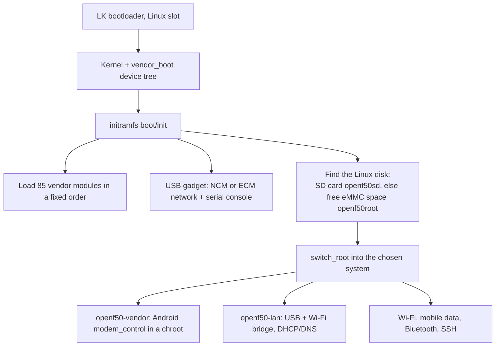

# Building from Source

**一句话概括：** 安装永远不需要本页（安装器会下载现成镜像），但一切都可以用 Docker 从公开源码构建。

**通俗版说明：** 发布包是面包房的面包。本页是配方，留给想自己烤或改配料的人。

完整的权威说明在
[docs/BUILD.md](https://github.com/dikeckaan/openf50-linux/blob/main/docs/BUILD.md)。本页是地图。

## 发布包包含什么

| 文件 | 内容 |
|---|---|
| `openf50-kernel.tar.gz` | Linux 5.4.254 `Image` 和模块（含 U30 Air 自己的）、静态 busybox 和 logdw、通用启动 ramdisk 段 |
| `openf50-kernel-6.18.tar.gz`、`openf50-kernel-7.2.tar.gz` | 主线内核及其模块 |
| `openf50-ubuntu-rootfs.tar.gz`、`openf50-ubuntu-26.04-rootfs.tar.gz` | Ubuntu 24.04 和 26.04 |
| `openf50-openwrt-rootfs.tar.gz`、`openf50-openwrt-luci-rootfs.tar.gz` | OpenWrt 25.12.5，纯净版和带控制面板版 |
| `openf50-extra-lang.tar.gz` | 更多网页界面语言 |
| `openf50-update` | 设备上的更新器 |
| `openf50-magisk-*.zip` | Magisk 安装包，每个系统和内核一个 |
| `SHA256SUMS`、`SHA256SUMS-magisk` | 校验和 |

镜像**不含专有文件**；安装器从你自己的设备取那些。

## 一次启动的经过



## 一步构建

```sh
kernel/build-all.sh    # -> out/Image, out/modules/*.ko, out/modules.builtin*
```

它从固定版本的公开源码带全部补丁构建 5.4 内核及其 Wi-Fi、蓝牙和 Mali 模块（Apple silicon 上约 10 分钟）。
然后：

* **根文件系统：** Ubuntu 从 `rootfs/`（Docker），OpenWrt 用 `openwrt/build-rootfs.sh`，带控制面板的系统
  用 `OPENF50_SYSTEM=openwrt-luci openwrt/build-rootfs.sh`。
* **安装你自己的构建：** `./install.sh --build` 使用你本地的内核产物并构建根文件系统，而不是下载。
* **发布：** `tools/make-release.sh TAG --publish`（它拒绝发布含固件、Android 文件、主机密钥或本地设置
  的镜像），或 GitHub Actions 里的 Release 工作流。
* **Magisk zip：** `tools/make-magisk-zips.sh RELEASE_DIR OUT_DIR`。

## 源码来源

* 5.4 内核：ZTE 为 U30 Air 发布的 GPL 源码，镜像在
  [dikeckaan/zte-ums9620-kernel-5.4.254](https://github.com/dikeckaan/zte-ums9620-kernel-5.4.254)。
* Wi-Fi、蓝牙和 GPU 驱动：realme C51/C53 AndroidT 内核发布（GPL-2.0）。
* 主线 6.18 和 7.2：kernel.org 的 Linux 加
  [`upstream/`](https://github.com/dikeckaan/openf50-linux/tree/main/upstream) 里的移植。
* 每个发布包的说明列出确切的源码提交。

## 其他发行版

Debian 13、Kali、Arch Linux ARM 和 ImmortalWrt 也能从本仓库构建；怎么构建、会有什么坑：
[docs/DISTROS.md](https://github.com/dikeckaan/openf50-linux/blob/main/docs/DISTROS.md)。发行版必须是
arm64 且能在你运行的内核上工作；init 系统不是 systemd 或 procd 的需要重写约 15 个服务。

## 仓库布局

| 路径 | 内容 |
|---|---|
| `install.sh`、`install.ps1`、`install.cmd` | 安装器（macOS/Linux、Windows） |
| `uninstall.*` | 卸载器 |
| `kernel/` | 内核构建环境、配置、补丁 |
| `upstream/` | 主线内核移植 |
| `boot/` | initramfs `init`、启动镜像构建器、槽位处理 |
| `rootfs/` | Ubuntu 镜像和 `overlay/` 里的设备服务 |
| `openwrt/` | OpenWrt 构建和控制面板 |
| `arch/` | Arch Linux ARM 构建 |
| `android/magisk/` | Magisk 模块和 zip 安装器 |
| `android-vendor/` | 从你的设备复制所需 Android 文件的脚本 |
| `tests/` | 单元测试 |
| `tools/` | 辅助工具：备份、日志、发布工具 |
| `docs/` | BUILD、DISTROS、FINDINGS |

## 许可证

脚本、工具和文档：MIT。内核和 `kernel/patches` 里的补丁：GPL-2.0。原厂固件和 Android 厂商组件属于其
所有者，不在此分发。
