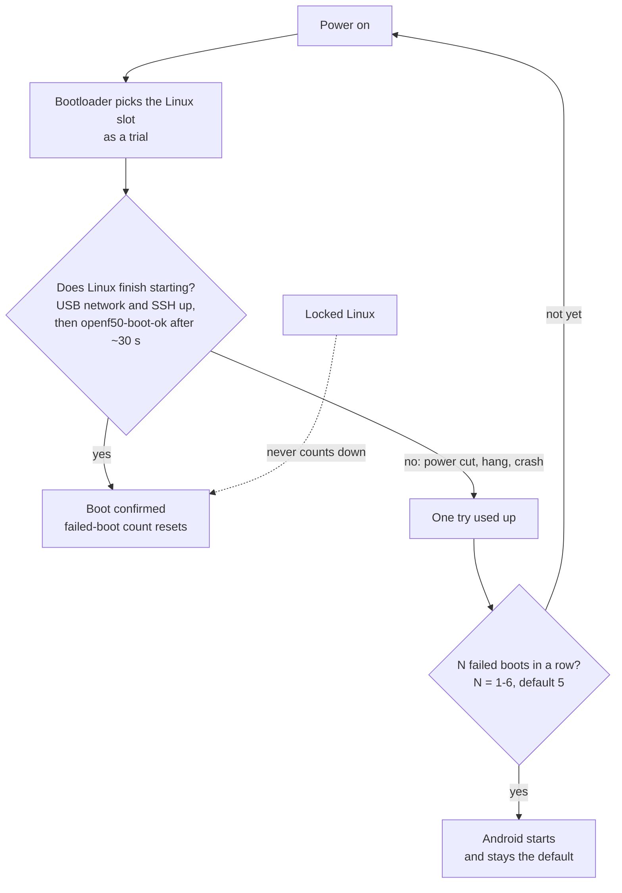

# Going Back to Android

**一句话概括：** Android 从不离开设备；`sudo openf50-next-boot android` 加一次重启带你回去，Android 里的
`su -c openf50-linux` 带你回 Linux，`./uninstall.sh` 彻底移除 Linux。

**通俗版说明：** 设备是一栋有两个房间的房子。Linux 是你默认走进的那个房间。如果 Linux 房间的门连续几
次卡住，设备会自己走进 Android 房间。你也可以随时自己走过去。


## 自动回退如何工作



* 次数在安装时选择（1-6，默认 5）。用 `sudo openf50-next-boot attempts N` 修改。
* 一次没走到 `openf50-boot-ok` 的启动（上电后约一分钟）算失败。一次成功的启动把计数清零。
* 如果 Linux 完全起不来，设备也会回到 Android，除非 Linux 被锁定。

## 手动切换

| 我想…… | 这样做 |
|---|---|
| 从 Linux 去 Android | `sudo openf50-next-boot android`，然后 `sudo reboot`（面板：**Switch to Android**） |
| 从 Android 去 Linux | 设备上 `su -c openf50-linux`，或 "OPENF50 Linux" Magisk 模块的 **Action** 按钮 |
| 看哪个系统在哪个槽位（Android） | `su -c 'openf50-linux status'` |
| 从电脑让 Android 设备去 Linux | `boot/android-boot-linux.sh work/boot-linux-slotb.img` |
| 让 Linux 重新成为默认 | `sudo openf50-next-boot linux` |
| 查看启动状态 | `sudo openf50-next-boot status` |

安装器替你把 Magisk 模块装进 Android。它只写安装器写的那同样的 32 字节 `misc`。面板上 "Switch to
Android" 会在频段或小区锁仍设置时警告（锁存在调制解调器里，在 Android 下也生效）并提议先重置它们。

### 没密码，没电脑

如果你忘了密码且 Linux 默认启动：设备上电约十秒后拔掉，再插上，连续重复你的失败启动计数次（默认 5
次）。设备随后看到未完成的启动并回退到 Android。新密码可以从电脑用 `tools/reset-password.sh` 设置，
无需启动 Linux（见 [Troubleshooting](Troubleshooting#i-forgot-the-password)）。Linux 被锁定时这**不**
起作用。

## 锁定的 Linux

```sh
sudo openf50-next-boot lock      # or "Lock Linux" on the panel's home page
sudo openf50-next-boot unlock    # back to the failed-boot attempts
```

锁定后，设备**绝不**自己去 Android：失败启动后不会，系统起不来时也不会。那种情况下它在 USB 上等待，
在设备地址提供 telnet shell，里面 `sh /run/to-android` 去 Android。Android 这时只能手动到达：
`openf50-next-boot android` 或面板上的 "Switch to Android"。

唯一的例外是新内核：`openf50-update` 让新启动镜像的最初几次启动按惯常次数计算，所以起不来的内核仍会
回退，而第一次成功的启动会再次锁定。

## 卸载

设备回到 Android 后：

```sh
./uninstall.sh                # macOS / Linux
.\uninstall.ps1               # Windows (PowerShell)
uninstall.cmd                 # Windows (cmd)
```

它让 Android 重新成为启动系统，恢复第二个 boot 分区并擦除 Linux 文件系统。你的 Android 数据不动。和
安装器一样，它会先提议把设备从 Linux 重启进 Android。

| 擦除选项 | 会发生什么 |
|---|---|
| **secure**（默认） | 覆写整个 Linux 区域，然后检查它是空的；需要几分钟 |
| **quick** | 只擦文件系统头；文件在闪存上仍可读，直到空间被复用 |
| **keep** | 留下 Linux 文件系统；它只是再也不启动 |

SD 卡上：**erase**（默认）覆写前 64 MiB，很快（文件在空间被复用前仍可读）；**keep** 留下卡。装着其他
文件系统的卡绝不被碰。

如果你在 32 GB 变体上收缩过 `userdata`，卸载器会提议把它扩回去。它默认关闭且会问两次，因为它会再次
清空 Android 的数据（而在 64 GB 设备上会把 Android 一直拥有的空闲区域还给它）。
