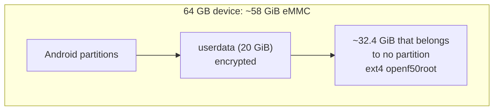

# Hardware Notes

**一句话概括：** F50 和 U30 Air（以及实验性的 V50）内部是同一台 Unisoc 小电脑，让 Linux 跑在它上面意味着
借用 Android 自己的几个程序，并绕过一些古怪的硬件。

本页是 [docs/FINDINGS.md](https://github.com/dikeckaan/openf50-linux/blob/main/docs/FINDINGS.md) 的通俗
摘要——那是项目的实验笔记本（记录每个遇到的问题的症状、成因和修复）。下面的节号（§）指向它。

## 部件

| 项目 | 参数 |
|---|---|
| SoC | Unisoc T760（UMS9620，"qogirn6pro"），板型 `ums9620_2h10_feimao` |
| 内存 | 2 GiB，Linux 可见约 1.4 GiB |
| 存储 | eMMC，64 GB 设备上约 58.25 GiB |
| Wi-Fi / 蓝牙 | PCIe 上的 SC2355 "Marlin3" |
| GPU | Mali-G57 |
| 引导加载器 | Unisoc LK，Trusty TEE，A/B 槽位 |
| U30 Air 额外部件 | 4050 mAh 电池、SGM41511（bq25601）充电器、电量计、NFC 标签、Wi-Fi 键 |
| V50 额外部件（实验性，§95） | 双 SIM 槽位、NFC、AW9523B LED 控制器；无电池 |

## 内存去了哪里（§27）

2 GiB 中，设备树为调制解调器固件保留 464 MiB（4G/5G 需要），为可信操作系统保留 24 MiB，还有一些较小的
区域；内核及其页表占用其余。Linux 看到约 1473 MiB。两块 Linux 不需要的区域（启动 logo 缓冲和引导加载器
崩溃转储）通过一个内核补丁还了回来。占内存一半的 zram 交换有所帮助。

## Linux 住在哪里（§9、§9b）

* 在 64 GB 设备上，`userdata` 之后约 32.4 GiB 不属于任何分区，读回来是空的。Linux 在那里放一个 ext4
  文件系统，通过固定偏移处的 loop 设备访问。分区表和 Android 不变。
* **为什么不放成 Android 存储里的一个文件？** `userdata` 是整体加密的（元数据加密，密钥由 Android
  持有），所以从 Linux 读出来是噪音。
* **为什么不用另一个看起来空闲的分区？** `blackbox` 和 `fulldumpdb` 看着没用，但固件会往里面写崩溃
  转储。
* 所以这段空隙就是全部了。在 **32 GB 变体**上没有空隙；收缩 `userdata`（最后一个分区，别的东西都不
  动）是实验性的造空隙办法，目前只在一台设备上手工做过。**SD 卡**（F50）是另一条路（§31k）。

## 调制解调器需要 Android 的帮手（§5、§18）

调制解调器和一个电源管理协处理器由 Android 自己的 `modem_control` 程序启动，它检查自己的进程名并期待
Android 的环境。Linux 在一个小 Android 沙箱（chroot）里运行它，连同 `refnotify` 和 `cp_diskserver`，
Android 库复制自**你的**设备。

**它们自己的账户（§41，v2026.10.20）。** Android 的 `system` 用户是 uid 1000，而在 Ubuntu 上 uid 1000
是 `ubuntu` 登录用户：这些守护进程过去以该用户运行，且调制解调器的校准分区（`nr_fixnv*`、
`persist`）——一旦丢失无法恢复——无需 `sudo` 就可被它写入。现在 `modem_control` 和 `refnotify` 以系统
账户 `openf50vnd` 运行，只保留它们在 Android 上拥有的能力，它们需要的设备节点归属该账户，GPU 节点归
`root:video`，`/dev` 里没有任何东西是全局可写或属于登录用户的。

**290 秒断电。** 早期，Linux 跑得好好的，然后启动约 290 秒后电源直接断了。电源协处理器里的看门狗从未
被告知退下，因为那条消息只有在 `modem_control` 启动它之后才能发出。运行 `modem_control` 解决了它（§5）。

## Wi-Fi：一次只干一件事（§14b、§23）

* 芯片只提供**一个**接入点：5 GHz **或** 2.4 GHz，不能同时。
* 它**要么**是热点，**要么**是另一个网络的客户端。模式在启动时选定，所以切到客户端模式需要重启；
  切回热点不需要。
* 5 GHz 热点模式需要一个补丁：固件从信标元素取信道，而标准 hostapd 只在 2.4 GHz 加那个元素。
* 仅 WPA3 的网络无法加入：驱动没有 SAE。

## 没声音，没屏幕

* **声音（§24、§24b）：** 板子没有扬声器通路和麦克风；放大器地址无人应答。整套 Unisoc 音频栈能编译
  能加载，但没有音频流动，无音频的通话约 20 秒后结束，和这板子在 Android 下一样。开发中，未进发布包。
* **屏幕：** USB-C 的 HDMI 不工作，因为 USB-C 供电协商芯片从不应答。这台设备是无头的。

## 6.18 上罕见的启动卡死（§31m，未解决）

一块板子在 6.18 下 50 次启动约有 2 次在最初几秒完全停住（另一台 F50：100 次中 0 次，7.2 亦然）。整颗
芯片无消息停转，看门狗将其复位，而引导加载器的崩溃转储处理会消耗好几次尝试，所以设备约 20 分钟后落在
Android。原因仍未查明。

## U30 Air：电池、按键、NFC、USB host

* **电池（§33d、§36）：** 电量、电压、电流、温度和充电状态，在 `openf50-toolkit`、面板和每个内核的
  `/sys/class/power_supply` 里都有。充电：5.4 上由厂商充电栈负责；6.18 和 7.2 上从 v2026.10.12 起由
  `bq256xx` 驱动负责。`openf50-power` 提供配置文件（`plugged`、`battery`、`saver`、`auto`）、空闲射频
  和**充电上限**（v2026.10.20 起：0 到 100 % 任意值，`sudo openf50-power charge-limit 80` 或
  `CHARGE_TO`；充到上限停止，低于上限 5 个百分点恢复，0 表示永不充电，电池永远不会被保持在 5 % 以下；
  之前只有 100 或 80）；高于 45 °C 时暂停充电。
* **Type-C 电流（§40，v2026.10.20，主线内核）：** 充电器过去从每个端口取 500 mA。现在读取 PMIC 的
  Type-C 模块，取 BC1.2 和 Type-C（Rp）电流中较大者，3 A 封顶到 2 A：在 1.5 或 3 A 端口上电池以约
  1.6 A 充电，而不是 0.36 A。
* **外部供电下的 host 模式：** VBUS 上有东西（带供电的 hub）时 `sudo openf50-usb host` 保持 5 V 升压
  关闭；仅靠电池时升压照旧提供 5 V。
* **充电启动：** 因插入充电器而开始的启动会保持充电启动状态（LED 闪烁，热点和调制解调器不工作），
  直到按下 Wi-Fi 键。
* **LED（§33f）：** 电池（白色：Linux 已启动）、网络（蓝色 4G，白色 5G，红色无服务）、Wi-Fi（白色
  2.4 GHz，蓝色 5 GHz）。`sudo openf50-led test` 显示谁是谁。
* **过热警报：** 芯片达到 85 °C 或电池达到 50 °C 时，电池 LED 依次闪红、白、蓝（`thermal-guard`）。
  F50 上由网络 LED 来做。
* **按键：** 电源键：短按点亮 LED，按住 3 秒关机。Wi-Fi 键：切换 2.4 / 5 GHz，按住 3 秒关闭或打开热点。
* **NFC（§33g）：** 手机贴近设备即可加入热点：`sudo openf50-nfc wifi` 把热点名称和密码写进标签
  （还有 `url`、`text`、`clear`、`on`/`off`）。
* **USB host（§33e）：** 在主线内核上，`sudo openf50-usb host` 配合 OTG 转接头：U 盘（FAT、exFAT）、
  键盘、鼠标、USB 调制解调器和网卡。`sudo openf50-usb device` 切回（每次启动的默认）。
* **地址：** `192.168.78.1`，这样一台 F50（`192.168.77.1`）和一台 U30 Air 可以同时插在一台电脑上
  （§33b）。

## F50 特有

* 仅 USB（无电池）；它的 USB 口就是电源，所以没有 USB host 模式。
* LED：网络（蓝色 4G，白色 5G，红色无服务）和 Wi-Fi（热点开启时亮）。
* 一个可以装 Linux 文件系统的 SD 卡槽。

## ZTE V50 (MU3351)：实验性（§95）

V50 是 F50 的平台（`ums9620_2h10_feimao`，T760）加双 SIM 槽位、NFC 和三个前灯。kano（kanoqwq）在他
的支线里把本项目移植到了它；**这里没有人有 V50，也没人测过**。

* **Linux 怎么认出它：** 它的设备树在 I2C3 的 0x5b 处有一个 AW9523B LED 控制器，任何 F50 或 U30 Air
  都没有（两边都查过：无此节点）。安装器只接受型号 `V50`、设备 `MU3351`、平台 `ums9620`。
* **内核：** 捆绑包点名 V50 的发布包的主线内核（6.18 或 7.2）；绝不用 5.4。除此之外它和 F50 一样运行，
  USB 供电，无电池：不绑定充电器（补丁 0016 只在 U30 Air 的充电器策略服务存在时才绑定 0x1a 充电器，
  V50 没有）。
* **LED：** NET1 是网络灯（蓝色 4G，白色 5G，红色无服务），Wi-Fi 灯 5 GHz 白色、2.4 GHz 蓝色，NET2
  不亮；`sudo openf50-led test` 逐个点亮，原始通道是 `aw9523b:pin0`-`15`。
* **eMMC：** 它的主机保持唤醒（补丁 0017）：kano 在主线下丢文件，直到做了这件事。
* **尚未支持：** 第二张 SIM（双 SIM 代码是 U30 Air 的）、NFC（复位线与 U30 Air 不同）、SIM 选择。
* **地址：** `192.168.79.1`。

## 看着奇怪但正常的数字

* **5.4 上负载均值约 12**（§6）：处于 D 状态等待的厂商内核线程被计入；`top` 显示 CPU 约 98 % 空闲。
* **6.18 上的内核警告**追溯到三个厂商 bug，已修复（§31g）。

想更深入，[FINDINGS 目录](https://github.com/dikeckaan/openf50-linux/blob/main/docs/FINDINGS.md#contents)
列出每一节及其状态（现行、已被取代、未解决）。
