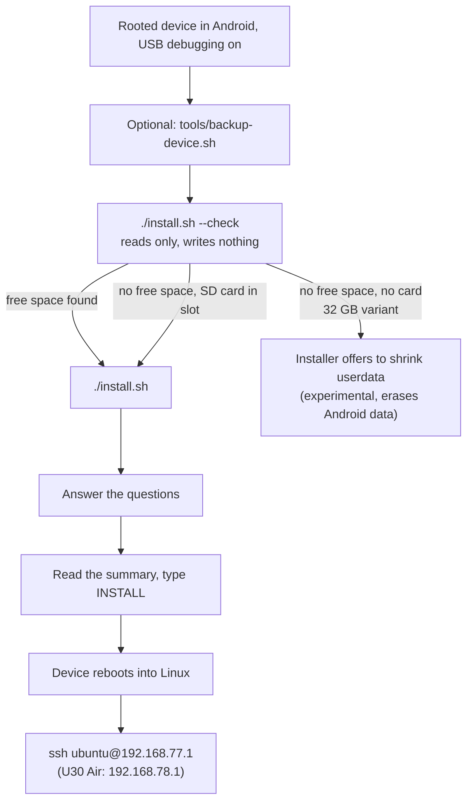
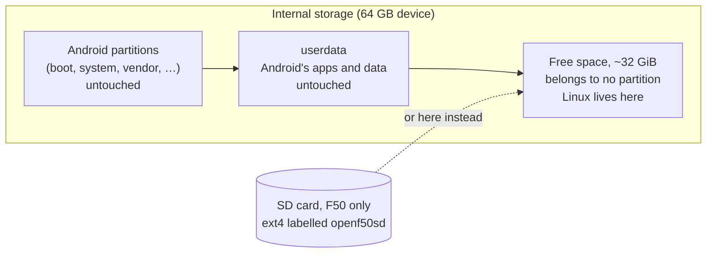

# Installation

**一句话概括：** 把已 root 的设备插到电脑上，先运行一个只*看*不动的脚本，再运行一次正式安装，回答几个问题，
输入 `INSTALL`，设备就会重启进入 Linux。

**通俗版说明：** 安装器是个细心的搬家公司。它先量好空房间（`--check`），精确告诉你哪个箱子放在哪里，
等你点头，并且绝不动 Android 的家具。

> **业余项目，无担保。** Root 和解锁不是本项目的一部分，风险自负。一次误操作、断电或一根坏数据线仍可能
> 让设备无法使用。请做好备份。见[完整声明](https://github.com/dikeckaan/openf50-linux#a-hobby-project-at-your-own-risk)。



## 你需要什么

* 一台已经 **root 并解锁**的 **ZTE F50 / OPENF50** 或 **ZTE U30 Air**：它必须已经能启动修改过的 Android
  启动镜像。如何做到这一步不属于本项目。
* 已开启 **USB 调试**，设备通过 USB 连接。
* 一台装有 **`adb`** 的电脑：
  * **macOS 或 Linux：** 另需 Python 3、`lz4` 和 `curl`（通常已自带）。
  * **Windows 10/11：** PowerShell。缺少时安装器会自行安装 Python 3（为你的用户，通过 winget 或来自
    python.org）及其 `lz4` 模块。使用 `install.ps1`，或在 cmd.exe 中用 `install.cmd`（无需修改
    执行策略）。
* 约 15 分钟。

用 `git clone https://github.com/dikeckaan/openf50-linux` 获取本项目，或从 GitHub 下载 zip。你不需要自己
下载镜像：安装器会获取最新发布包并校验其 SHA256。

## 会写入什么（以及绝不写什么）

* Linux 装进内置存储中**空闲、未使用的空间**（常见的 64 GB 设备上约 32 GiB），或装到 **SD 卡**上
  （仅 F50）。
* 安装器写入 Android **不在**的那个槽位的 boot 分区（`boot_b`，当 Android 从槽位 b 运行时则写 `boot_a`，
  OTA 更新后常常如此）以及 **32 字节的 `misc`**。
* 在 64 GB 设备上，**Android、其数据和分区表绝不被修改。**
* 例外是 32 GB 变体，见下文。
* 从 v2026.10.20 起，安装器还会在两个槽位不同时把 Android 槽位的**启动链**复制到 Linux 槽位，见
  [下文](#the-boot-chain-of-the-linux-slot)。

### Linux 槽位的启动链

Linux 用它自己槽位的引导链启动，但运行 Android 的调制解调器。Android 更新（OTA）之后，两个槽位里的
固件版本不同，而 Linux 槽位的链还是出厂那套，这曾让更新过的设备无法启动调制解调器（issue #86）。所以
安装器在两者不同时，把 Android 槽位的 `uboot`、`sml`、`teecfg`、`trustos` 和 `vbmeta` 复制到 Linux
槽位——只复制这五个，绝不碰 NV 或校准分区，也不碰 Android 槽位的其他任何东西。Linux 槽位原有的镜像会先
备份（Linux 文件系统上的 `.openf50/bootchain/` 和电脑上的 `work/bootchain/`），每个写入的镜像都会回读，
不匹配就把旧的放回去并在 Linux 武装之前停止。摘要会说明它将做什么（从未更新过的设备上是 "boot chain:
identical on both slots"）。专家可用 `OPENF50_SYNC_BOOTCHAIN=0` 跳过（`install.ps1 -NoBootchainSync`）。
在 Android 里，`su -c 'openf50-linux bootchain'` 查看状态，`... bootchain sync` 执行复制。感谢 kano 的
建议。



## 第 0 步：备份无法替代的东西（推荐）

```sh
tools/backup-device.sh          # macOS / Linux, device in rooted Android
```

它把你这台机器独有的数据（`prodnv`、调制解调器校准和 IMEI 分区、引导链）复制到电脑并校验每一份转储。
安装绝不碰这些，但一旦丢失，任何固件下载都无法找回。请妥善保管该文件夹：里面有你的 IMEI。

## 第 1 步：检查设备（只读）

```sh
./install.sh --check          # macOS / Linux
.\install.ps1 -Check          # Windows (PowerShell)
install.cmd -Check            # Windows (cmd)
```

它打印存储容量、Android 分区到哪里结束、后面有多少空闲空间。结果的含义：

| `--check` 说 | 含义 |
|---|---|
| 约 32 GiB 空闲，`OK: free and empty, same layout as the tested device` | 常见的 64 GB 设备，就绪 |
| `OK: free and empty, smaller than on the tested device but enough for both systems` | 没问题 |
| `room for one system only` / `OpenWrt fits, Ubuntu does not` | 空隙较小：据此选择 |
| 完全没有空闲空间 | **32 GB 变体**（见下文） |
| `the installer will offer the SD card instead` | 内部没地方，但卡槽里有卡：无需重新分区 |
| `WARNING: the unpartitioned space is not empty` | 有东西写过那里；安装将覆盖它（你需要输入 `overwrite`） |

如果数字与这些都不像，停下来，带着 `--check` 的输出[开一个 issue](https://github.com/dikeckaan/openf50-linux/issues)。

### 32 GB 变体

在 32 GB 设备上 `userdata` 占满整盘，所以没有空闲空间。你有两条路：

* **SD 卡（F50）：** 不动内置存储上的任何东西。安装器会主动提供。
* **收缩 `userdata`：** 安装器可以腾出空间，会问给 Linux 多少 GiB，并至少给 Android 留 4 GiB。
  **这会重写分区表并清空 Android 里的一切。它是实验性的**，你必须输入 `ERASE`。先用
  `tools/backup-device.sh` 做完整备份。Android 会在下次启动时重新初始化它的数据；然后再运行一次安装器。

### SD 卡（仅 F50）

卡槽里有一张至少 700 MiB 的卡时，安装器会问 Linux 装到卡上还是内置空闲空间（`OPENF50_STORAGE=sd` 可直接
回答）。卡会被格式化为 ext4，卷标 `openf50sd`；已装有其他 Linux（ext4）文件系统的卡绝不会被格式化。
请在设备**关机**时插卡。`openf50sd` 卡总是优先启动。注意：启动镜像会启动*任何*卷标为 `openf50sd` 的卡，
所以拿到设备的人可以从卡上启动他们自己的系统。U30 Air 没有卡槽。

## 第 2 步：安装

```sh
./install.sh                  # macOS / Linux
.\install.ps1                 # Windows (PowerShell)
install.cmd                   # Windows (cmd)
```

它先把你这份项目副本从 GitHub 更新到最新，如有变化则自我重启（`OPENF50_NO_SELF_UPDATE=1` /
`-NoSelfUpdate` 可跳过）。然后问语言：English、Türkçe 或 中文（`OPENF50_LANG=tr` 或
`.\install.ps1 -Lang zh` 可跳过此问题）。

### 逐个问题

| 安装器问 | 含义 | 拿不准时 |
|---|---|---|
| *Where should the Linux filesystem go: internal storage or the SD card?*（仅在有卡时） | Linux 住在哪里 | 64 GB 设备上选 `internal` |
| *What should be installed?* 1) Ubuntu LTS 2) OpenWrt 3) both | 装哪个（些）系统；见 [Choosing a System](Choosing-a-System) | 默认 3（都装） |
| *Which OpenWrt?* 1) the standard LuCI web interface 2) with the OPENF50 control panel | 纯净 OpenWrt，还是带调制解调器面板的 OpenWrt | 见 [Control Panel (LuCI)](Control-Panel-(LuCI)) |
| *Which one should boot* | 装两个系统时：哪个先启动 | 都行；之后可用 `openf50-os` 切换 |
| *Which Ubuntu?* 1) 24.04 LTS 2) 26.04 LTS | Ubuntu 版本 | 24.04（测试时间最长） |
| *Boot Linux by default instead of Android?* | 是：每次上电启动 Linux，启动失败若干次后进 Android | 是 |
| *Failed boots before Android (1-6)* | 连续多少次未完成的启动后放弃并回退到 Android | 5（默认） |
| *Copy Android's hotspot name and password to Linux?* | 你的 Wi-Fi 保持原来的名称和密码 | 是 |
| *Include the Mali GPU (OpenCL) userspace (~90 MiB)?* | GPU 计算支持 | 是 |
| *Install the VPN module?* | 可选的 [VPN](VPN)（约需下载 40 MB） | 否，需要时以后再加 |
| *Install the web panel for Ubuntu?*（仅 Ubuntu） | Cockpit 加 OPENF50 页面，来自发布包的离线文件（约多 24 MB；见 [Control Panel (LuCI)](Control-Panel-(LuCI)#a-web-panel-on-ubuntu-cockpit)） | 否，以后可用 `openf50-extra install panel` 添加 |
| *adb to Linux is on and lets every computer in ... Let in only this computer's adb key instead?* | 经数据线连到 Linux 的 adb 默认开启，任何插上数据线的人都能得到 root shell 且无需密码；答 `yes` 则只允许你用于安装的这台电脑（见 [adb to Linux](#adb-to-linux)） | 否（所有电脑；之后可用 `openf50-usb adb auth keys` 或 `openf50-usb adb off` 改） |
| *Which kernel?* 1) 5.4 2) 6.18 3) 7.2 | Linux 的核心；见 [Kernels](Kernels) | 1（5.4），Ubuntu 26.04 选 2（6.18） |
| *update or wipe*（仅在已有 Linux 时） | `update` 保留设置和数据，`wipe` 重新开始 | update |
| *Password for the "ubuntu" user (Ubuntu) and "root" (OpenWrt)* | 你的登录密码，至少 6 个字符 | 选个好的 |

**关于失败启动计数：** 一次启动在上电后约一分钟内没有完成启动（断电、电池耗尽、Linux 卡死）就算失败。
一次成功的启动会把计数清零。数值高对接触不良的数据线更宽容；数值低让你更快回到 Android。它也是你不用
电脑回到 Android 的方法：在它启动时连续断电这么多次。

### 摘要和 `INSTALL`

安装器下载镜像，**从你自己的设备**复制 Wi-Fi 和调制解调器文件（发布的镜像不含任何专有文件），然后精确
展示它将写入什么，例如：

```
==> Ready to install
  systems:        ubuntu openwrt (Ubuntu 24.04) (boots: ubuntu)
  kernel:         6.18 (mainline, …)
  default boot:   Linux (Android after 5 failed boots in a row)
  filesystem:     CREATE new ext4 (erases the Linux region)
  writes:         Linux region at offset …, boot_b, 32 bytes of misc (boot_a, GPT and userdata are not touched)
Type INSTALL to continue [no]:
```

输入 `INSTALL`（大写）继续；输入其他任何内容都会取消。它还会在 Android 里装一个小 Magisk 模块，以便你
以后从 Android 启动 Linux，然后重启进入 Linux。

如果你开始时设备运行的是 Linux 而不是 Android，安装器会察觉并提议帮你重启进 Android：设备允许电脑进入
时走 adb（默认；无需输入密码），否则走 SSH。处于 Linux 的设备也会出现在 `adb devices` 里，显示为
`OPENF50LINUX-...`，绝不会被当作安装目标。

## 第 3 步：登录

等约一分钟，然后在设备所插的电脑上：

| | F50 / OPENF50 | U30 Air |
|---|---|---|
| Ubuntu | `ssh ubuntu@192.168.77.1` | `ssh ubuntu@192.168.78.1` |
| OpenWrt | `ssh root@192.168.77.1` | `ssh root@192.168.78.1` |
| OpenWrt 网页界面 | http://192.168.77.1 | http://192.168.78.1 |

使用你选的密码。设备广播的 Wi-Fi 网络就是它的热点；除非你另有选择，它的名称和密码是从 Android 复制来
的。USB 串口控制台也在：macOS 上用 `screen /dev/cu.usbmodem* 115200`。然后试试 `sudo openf50-toolkit`。

**macOS 提示：** macOS 在锁屏时不会配置它从未见过的网络接口。第一次插设备时请解锁 Mac。

### 连到 Linux 的 adb

Linux 在同一条数据线上提供 `adb`，与 USB 网络和串口控制台并存，和 Android 一样：`adb shell`
（root shell）、`adb push`/`pull`、`adb forward`。从 v2026.10.23 之后的发布包起，它**默认开启且让所有
电脑进入**，这样网页安装器（浏览器）或 GUI 无需先放密钥就能与设备通信。

**这意味着什么：** adb 没有密码。默认情况下，**任何能把 USB 数据线插到设备上的人都能得到 root shell**，
在你设置密码之后也一样，并且可以读取和修改上面的一切。它只存在于数据线上：Wi-Fi、LAN 或移动数据都
够不到它。如果设备可能离开你的掌控，请关闭它：

```sh
sudo openf50-usb adb auth keys                        # only computers whose key you authorised get in
sudo openf50-usb adb off                              # no adb at all
```

两者在重启和更新后都保持。其余用法：

```sh
openf50-usb adb status                                # on or off, whom it lets in
scp ~/.android/adbkey.pub ubuntu@192.168.77.1:      # a computer's key (root@ on OpenWrt; .78.1 on a U30 Air)
sudo openf50-usb adb key ~/adbkey.pub                 # authorise it (/etc/openf50/adb_keys), for "auth keys"
sudo openf50-usb adb keys                             # the authorised keys
sudo openf50-usb adb auth open                        # every computer again
sudo openf50-usb adb on                               # after "off"
```

之前配置过的设备保持原样：`adb off` 保持关闭，在 v2026.10.20-23 期间开启过 adb 或授权过密钥的设备保持
仅密钥模式，直到 `sudo openf50-usb adb auth open`。其他所有设备在更新后 adb 开启且开放。安装器会问是否
只让它运行的这台电脑进入；Magisk zip 不问，它装的系统以开放状态启动。

设备在 `adb devices` 中显示为 `OPENF50LINUX-...`。密钥模式下，密钥未授权的电脑会看到 `unauthorized` 且
一无所获（设备上也不会有提示）。两种模式下都没有 TCP 端口。adb 需要带 FunctionFS 的内核：5.4，或
v2026.10.20 及更新的主线内核；U30 Air 的端口处于 USB host 模式时没有 adb。

## 从浏览器安装：网页安装器

https://kaandikec.com/openf50-linux/web-installer/ 从 **Chrome 或 Edge** 经 USB 安装、更新和移除 Linux，
电脑上无需 adb、Python 或脚本。**已测试**（2026-10-13，发布包 v2026.10.25）：在 macOS 的 Chrome 155 上
对一台 F50（64 GB，Magisk 30.6）从头到尾——单系统和双系统、中途关掉标签页、启动和管理 Linux、回到
Android、卸载。**尚未测试：** Windows（adb 接口需要 WinUSB 驱动）、Linux 电脑（需要 udev 规则）、U30
Air、以 SD 卡为目标、Magisk 以外的 root 管理器，以及设备自己经真实移动数据下载。上述场景请用前面的
安装器。

* 它需要一台用 **Magisk 26 或更新** root 的设备、开启 USB 调试，以及比 `v2026.10.23` 新的发布包。它会
  显示设备是否已 root、引导加载器报告的锁状态，并且两者都不改变。F50 没有屏幕：它的 Android 不问就
  让任何电脑的 adb 进入，且 Magisk 必须已经允许 "Shell" root——电脑版安装器也需要它（如果没有：通过
  scrcpy 打开 Magisk 应用，Superuser）。
* 你选择系统、内核和发布包；页面给出文件名和大小，并让**设备自己**从 GitHub 的发布包下载，走设备自己
  的网络连接（每个系统 39 到 124 MB 移动数据；断掉的下载会续传）。没有连接的设备会被区分出来，此时
  页面接受你下载的文件（GitHub 不允许页面读取发布文件）。无论哪种方式，设备只在校验 GitHub 公布的
  校验和后使用该文件。然后页面在设备上以你的回答启动 **zip 自带的安装器**并显示进度。关掉标签页不会
  停止它：重新连接，页面会显示进行到哪一步。
* 它可以备份安装所写入的东西（IMEI/校准分区不行：那些用 `tools/backup-device.sh`）、卸载，以及管理
  一台运行 Linux 且 adb 开启的设备（更新、内核、重启、日志）。
* 它不会在 32 GB 变体上收缩 `userdata`。
* 如果浏览器打不开设备：另一个程序占着它——停掉正在运行的 adb 服务（`adb kill-server`），并关掉其他
  打开并连接着该页面的浏览器窗口或标签页；在 Windows 上 adb 接口需要 WinUSB 驱动；在 Linux 上需要
  udev 规则。页面会说明是哪一种，并给出细节。
* 页面里的 "Restart into Android" 会把 Android 设为默认启动（它就是 `openf50-next-boot android`）；
  页面的 Linux 视图里的 "Make Linux the default again"，或 `openf50-next-boot linux`，可以撤销。

它的构建方式和测试方法：[docs/web-installer.md](https://github.com/dikeckaan/openf50-linux/blob/main/docs/web-installer.md)。

## 从 Android 用 Magisk zip 安装（无需电脑）

如果设备运行着已 root 的 Android 且有 **Magisk 26 或更新**，Linux 可以从设备自身安装。每个发布包按系统
和内核各有一个 zip，共 11 个，例如 `openf50-magisk-<tag>-ubuntu-24.04-k5.4.zip` 或
`openf50-magisk-<tag>-openwrt-luci-k7.2.zip`（带控制面板的 OpenWrt）；同一个 zip 在 F50 和 U30 Air 上
都可用，会自己找到位置。没有内核 5.4 的 Ubuntu 26.04 zip。

1. 把 zip 放到设备上，在 Magisk 应用里打开（模块、从存储安装），或运行
   `su -c 'magisk --install-module /sdcard/Download/<zip>'`。不要从 recovery 安装。
2. 阅读输出：它显示设备、Linux 装到哪里、写什么，以及**哪个密码可用**——镜像自带的：Ubuntu 的用户
   `ubuntu` 密码为 `ubuntu`，OpenWrt 的 `root` 在你设置之前没有密码（`passwd`，或 LuCI 的
   System > Administration）；设置文件里的 `OPENF50_PASSWORD` 可设置你自己的密码。同样的说明在
   `/data/adb/openf50-linux-password.txt`（`su -c cat /data/adb/openf50-linux-password.txt`）。
3. 重启。如果 Linux 没起来，设备会自己回到 Android。

Magisk 无法提问，所以选择写在一个设置文件 `openf50-install.conf` 里。zip 不提供收缩 `userdata`。各个
键、文件可放的位置和擦除规则在
[README](https://github.com/dikeckaan/openf50-linux#choosing-something-else-openf50-installconf) 中。

## 下载慢？

GitHub 的发布 CDN 在某些地区会对单连接限速。安装器已经用 8 个并行分块下载；`OPENF50_FETCH_JOBS` 可以改
这个数，`OPENF50_RELEASE_URL` 可以指向你自己的镜像。

## 接下来

* 还没决定的话：[Choosing a System](Choosing-a-System) 和 [Kernels](Kernels)
* [Going Back to Android](Going-Back-to-Android)
* [Troubleshooting](Troubleshooting)
* 图文指南：https://kaandikec.com/openf50-linux/install/
