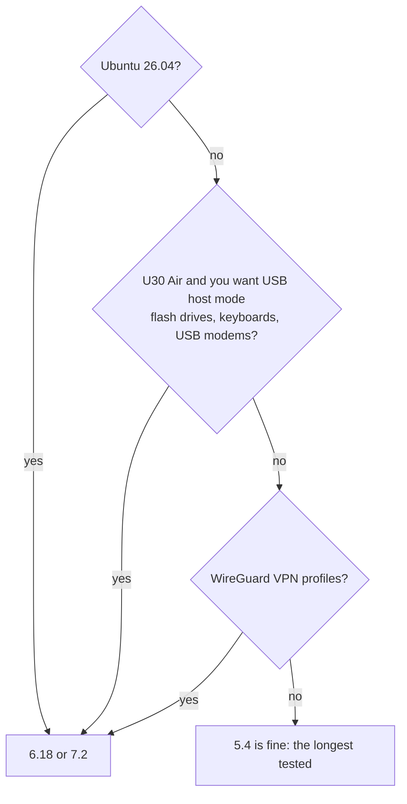

# Kernels

**一句话概括：** 内核是 Linux 底下的引擎；你可以选 Unisoc 自己的 **5.4**（最老、测试最久）、主线
**6.18**（长期支持）或主线 **7.2**（最新），以后改主意也只需一条命令。

**通俗版说明：** 三个引擎驱动同一辆车：热点、移动数据、短信、蓝牙、VPN、GPU。5.4 是工厂造的那台，最
经得起考验；6.18 和 7.2 是大家都在用的常规 Linux，部件更新。

## 安装器给出的选择

| 选项 | 内核 | |
|---|---|---|
| 1 | **5.4** | Unisoc 的厂商内核（Android 12 底）：测试最久，本项目支持的一切功能 |
| 2 | **6.18** | 主线 Linux，当前长期支持（LTS）版本：更新的驱动和安全修复，同样的功能（热点、移动数据、短信、蓝牙、VPN、GPU）；尚无 USB-C 视频输出 |
| 3 | **7.2** | 最新的稳定主线版本（目前是 7.2）：最新的驱动，与 6.18 同样的功能；测试不如 6.18 充分 |

## 我该选哪个？



* **Ubuntu 26.04 需要 6.18 或 7.2。** 它的程序用到 5.4 没有的系统调用。
* **U30 Air 的 USB host 模式**（`openf50-usb host`）需要主线内核。
* **WireGuard：** VPN 模块注明 5.4 厂商内核没有 WireGuard；主线有。
* **KVM**（`/dev/kvm`）三个都有。
* **主线捆绑包**带约 360 个模块：WireGuard、SQM、隧道、USB 网卡和调制解调器、
  NTFS/exFAT/btrfs/NFS/CIFS、dm-crypt、容器。
* **U30 Air 电池：** 读数在每个内核上都可用。主线内核上的充电从 v2026.10.12 起由 `bq256xx` 驱动负责；
  v2026.10.11 及更早的主线内核不开充电，所以那边用 5.4。从 v2026.10.20 起主线内核还会读取 Type-C 端口
  提供的电流（1.5 或 3 A），所以在这类端口上充电最高以 2 A 进行，而不是 500 mA；充电上限（0-100 %）
  在每个内核上都可用。
* **dae**（VPN 模块的 eBPF 引擎）需要 **v2026.10.20 或更新**的 6.18 或 7.2：那些内核（6.18.56 和
  7.2.10）带 BTF 和 BPF JIT。5.4 跑不了它。kprobes 被有意排除：有了它们 7.2 在 36 次启动里失败 2 次，
  所以 `dae trace` 不可用。

## v2026.10.25 里的版本

| 内核 | 版本 | 说明 |
|---|---|---|
| 5.4 | 5.4.254 | Unisoc 厂商内核加本项目补丁，自 v2026.10.23 起未变——那次加了 `NFT_QUEUE`（nftables 的 `queue` 裁决，给用户态数据包工具用）；自 v2026.10.21 起，网络命名空间消失时不再 panic（#103），Wi-Fi 驱动的例行行不再是错误（#140） |
| 6.18 | 6.18.56 | longterm；BTF、BPF JIT、FunctionFS（给 adb）；v2026.10.25 重建：U30 Air 的充电器也会在 0x1a 处寻找（SGM41513，#102）；v2026.10.23 加入 `openf50_thermal` 模块（板子温度作为热区）；自 v2026.10.22 起 F50 的 SD 卡槽有真正的卡检测（EIC 控制器六个 bank 全部映射），空卡槽不再被轮询，日志里不再有 `mmc1` 寄存器转储（#181）；自 v2026.10.21 起 Wi-Fi 驱动可以卸载（#146）且更安静（#140） |
| 7.2 | 7.2.10 | stable；同样的新增、同样的卡检测修复、同样的模块 |

这些点发布还带来了：一个 DWC3 USB 修复（IRQ 风暴曾能让板子 panic）、netfilter flowtable 和 fq_codel
修复、蓝牙和 USB 串口的 use-after-free 修复等。BTF 数据占启动镜像约 4 MB、内存 4 MiB。

## 已知问题：6.18 上罕见的卡死

一块板子上 6.18 大约每 20 次启动有 1 次在最初几秒停住；设备随后回退到 Android（可能需要约 20 分钟，
因为每次卡死消耗好几次尝试）。另一台 F50 在 100 次启动中 0 次，7.2 也一样。在 Android 里用
`su -c openf50-linux` 或 Magisk 模块的 Action 按钮再次启动 Linux。细节：
[FINDINGS 31m](https://github.com/dikeckaan/openf50-linux/blob/main/docs/FINDINGS.md#31m-hard-hangs-in-the-first-seconds-under-618-open)。

## 以后换内核

在设备上：

```sh
sudo openf50-update kernel            # shows the current one
sudo openf50-update kernel 6.18       # or 5.4, 7.2
sudo reboot
```

旧内核和启动镜像会保留：`sudo openf50-update rollback-boot` 回去。起不来的新内核会在惯常的失败启动次数
后把设备送回 Android，即使 Linux 被锁定也一样（见 [Going Back to Android](Going-Back-to-Android)）。

## 内核从哪来

* **5.4** 构建自 ZTE 为 U30 Air 公布的 GPL 源码（镜像在
  [dikeckaan/zte-ums9620-kernel-5.4.254](https://github.com/dikeckaan/zte-ums9620-kernel-5.4.254)），
  Wi-Fi、蓝牙和 GPU 驱动来自 realme 的 C51/C53 内核发布。
* **6.18 和 7.2** 是 kernel.org 的 Linux 加本项目的补丁和移植过来的厂商驱动
  （[`upstream/`](https://github.com/dikeckaan/openf50-linux/tree/main/upstream)）。一个 CI 任务每周用
  最新的 longterm 和 stable 内核构建这个移植。

F50 和 U30 Air 跑同一个内核；U30 Air 的启动镜像为它的充电器和 LED 多加载几个驱动。
