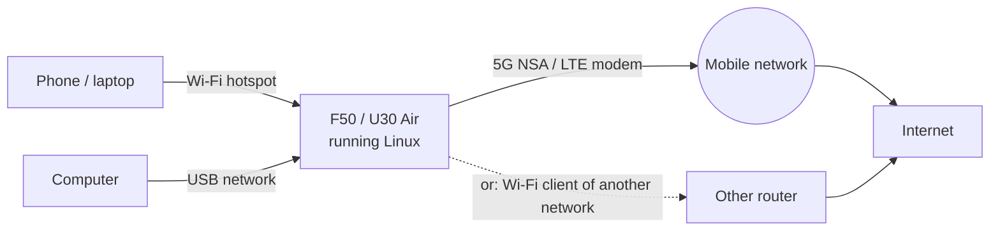

# Mobile Data and APN

**一句话概括：** 把有流量套餐的 SIM 卡放进设备，Linux 会自己连上 5G（NSA）或 LTE，并把连接分享给它的
Wi-Fi 和 USB 上的一切。

**通俗版说明：** 调制解调器是盒子里的一部小手机。Linux 替你拨号，一直盯着线路，掉了就再拨。大多数 SIM
卡完全不需要设置。




## 检查它

```sh
sudo mobile-data status
```

OpenWrt 上不需要 `sudo`。连接在调制解调器复位后会自己重连（`openf50-mobile-data-watch`），除非你自己用
`mobile-data down` 把它停了。其他子命令：`up [APN]`、`down`、`signal`、`sim-reset`。

**没网？** 先确认 SIM 卡有**流量套餐**。没有套餐的表现就是连接不停地掉。

## APN

**除非运营商另有说明，否则留空。** 留空的意思是：使用 SIM 卡自己定义的数据上下文，这正是大多数运营商
所期望的。

| 系统 | 位置 |
|---|---|
| Ubuntu | `/etc/openf50/mobile-data.conf`：`OPENF50_APN` 和 `OPENF50_PDP_TYPE`（示例在 `/etc/openf50/mobile-data.conf.example`） |
| OpenWrt | LuCI -> Network -> Interfaces -> wan，或 `uci set network.wan.apn='…'; uci commit network; ifup wan` |

**带用户名和密码的 APN**（私有 APN、一些 MVNO）：在 APN 旁边设置它们。它们需要有 APN 才能用；可打印
ASCII，各最多 64 个字符，不含引号和反斜杠。认证方式为 `pap`、`chap`、`both`（由网络选择，默认值）或
`none`。

| 系统 | 位置 |
|---|---|
| Ubuntu | `/etc/openf50/mobile-data.conf` 中的 `OPENF50_APN_USER`、`OPENF50_APN_PASSWORD`、`OPENF50_APN_AUTH` |
| OpenWrt | 同一页面（APN user name、APN password、APN authentication），或 `uci set network.wan.username='…'; uci set network.wan.password='…'; uci set network.wan.auth='chap'; uci commit network; ifup wan` |

存放密码的文件必须只有 root 可读；拨号会把它改成这样（`chmod 600`），否则不启动；有用户名或密码却没有
APN 会被拒绝而不是被忽略。这是新功能，尚未在会校验凭据的网络上试过；如果你的运营商需要它，无论结果
如何都欢迎反馈。

## 流量统计

设备按天和按账期、双向统计移动数据，和运营商的算法一样。统计跨重启、跨系统切换保留，不会重复计数。
在带控制面板的 OpenWrt 上这是 Cellular > Data usage。

```sh
openf50-traffic                       # today, this billing cycle and the cap
sudo openf50-traffic set reset-day 1  # the day a billing cycle starts
sudo openf50-traffic set cap 50G      # a monthly cap; it warns at 90 % unless you set another level
sudo openf50-traffic set cut on       # optional: mobile data off at the cap, back on when the next cycle starts
openf50-traffic days                  # the last days with traffic
```

## 网络、频段和小区锁（控制面板）

在带控制面板的 OpenWrt 上，**Cellular -> Network locks** 设置网络模式、频段、小区和 EN-DC 锁，跨重启
保持并在启动时重放。锁存在调制解调器自己的存储里，所以**在 Android 下也同样生效**。该页面的
"Reset all to automatic"（或命令行的 `unisoc-modem lock reset`）清除它们。**状态仪表盘**显示实时信号、
频段、小区和温度。见 [Control Panel (LuCI)](Control-Panel-(LuCI))。

## USSD（余额、本机号码）

```sh
sudo openf50-ussd '*101#'
```

具体代码取决于你的运营商。

## TTL

```sh
sudo openf50-ttl set 64     # a fixed TTL for everything leaving through mobile data
sudo openf50-ttl off        # back to the default
```

也在 `openf50-toolkit` -> Network -> TTL，或面板的 Cellular -> TTL 里。在主线内核上规则在 tc 里，流量
卸载保持开启；在 5.4 上它在 nftables 里，设置 TTL 期间卸载关闭。

> 改动设备发出的东西（TTL、频段锁、VPN）可能违反运营商条款或当地法律。开启前请先确认。

## IPv6

纯净 OpenWrt 用前缀扩展；带控制面板的 OpenWrt 改为中继来自运营商的 IPv6（路由器通告和 NAT66）。从
v2026.10.18 起，当运营商把设备移到新的 /64 时，旧前缀会被撤回，客户端无需重启 WAN 就会停用它。

## Wi-Fi 优先于移动数据

当设备同时作为客户端加入了另一个 Wi-Fi 网络时，Wi-Fi 路由（metric 50）胜过移动数据（metric 100），
SIM 保持空闲。见 [Wi-Fi Hotspot and Client](Wi-Fi-Hotspot-and-Client)。

## "网站以为我在另一个国家"

设备没有 GPS，所以网站根据 IP 地址猜你的位置，而移动运营商常常看起来像另一个城市。

## 省电（U30 Air）

`openf50-power` 可以在无人连接时把射频切到仅 LTE 或关闭。见
[README 的电源一行](https://github.com/dikeckaan/openf50-linux#everyday-use)和
[Hardware Notes](Hardware-Notes#u30-air-battery-buttons-nfc-usb-host)。

深层细节（射频注册、数据承载、调制解调器复位）：
[FINDINGS 15、26](https://github.com/dikeckaan/openf50-linux/blob/main/docs/FINDINGS.md)。
