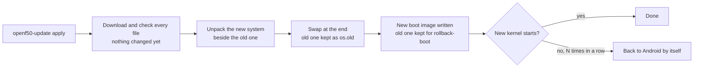

# Updating

**一句话概括：** `sudo openf50-update check` 告诉你是否有新发布包，`sudo openf50-update apply` 在设备上
直接安装它，`rollback` 在你不喜欢时带你回去。

**通俗版说明：** 设备在旧系统旁边把新系统搭好，只在最后一刻才交换两者。下载中途断了，什么都没变。旧
系统留在柜子里，直到你把它扔掉。

## 命令

```sh
sudo openf50-update check           # installed version vs newest release
sudo openf50-update apply           # system, kernel and boot image: download, unpack, switch; then reboot
sudo openf50-update rollback        # back to the previous system
sudo openf50-update rollback-boot   # back to the previous kernel and boot image
sudo openf50-update kernel 7.2      # another kernel: 5.4 (vendor), 6.18 (LTS) or 7.2; no argument shows the current one
sudo openf50-update clean           # delete the kept previous version
```

在 OpenWrt 上你已经是 root，所以去掉 `sudo`。`openf50-toolkit` 在 **System -> Software update** 下提供
同样的功能。`apply` 之后重启，以启动新系统和新内核。一次只跑一个：一个 `openf50-update` 进行中再启动
第二个会被拒绝，并指出第一个的 pid（v2026.10.21 起）。

设备在启动时和每 6 小时检查一次新发布包，并在登录时和 `openf50-toolkit` 里告诉你。**它绝不自行安装。**

## 更新保留什么

* 你的设置（`/etc/openf50`：热点、VPN、工具包）、用户和家目录、`/usr/local`、SSH 主机密钥、OpenWrt 的
  UCI 配置和你自己启用的服务；
* OpenWrt **System -> Scheduled Tasks** 的任务（`/etc/crontabs`；更新以前会丢掉它们，目录一空 `crond`
  就根本不启动）；
* 从你的设备复制的厂商文件（Wi-Fi 固件、Android 调制解调器用户态）；
* 已安装的 extras：lang extra 被带到新发布包，[VPN](VPN) 模块更新到它的最新发布包；
* 你自己安装的软件包（`apk add`、`apt install`）：见下文。

## 你自己安装的软件包

发布包镜像里只有它自己的软件包。`apply` 在切换前列出你添加的那些，新系统在首次启动、联网之后重新安装
它们（尝试一小时，然后接下来的启动再试，最多五次）。在它们回来之前，它们的 OpenWrt 设置
（`/etc/config/<name>`）在 `/etc/openf50/orphaned-config/` 里等待：没有程序的设置以前会保持生效——
OpenClash 的残留曾让设备失去 DNS。软件源里没有的包（从 `.apk` 文件装的）无法自己回来；它的设置留在
一边。服务按原样恢复启用或禁用状态（OpenWrt 的 init 脚本，Ubuntu 的 systemd 单元）。

在 Ubuntu 上，你添加的 apt 源（`/etc/apt/sources.list.d`、PPA，连同它们指名的密钥，以及你在
`/etc/apt/preferences.d` 里的 pinning）都会保留，所以它们的包可以回来；镜像自己的源绝不替换。一个让
`apt-get update` 失败的保留源（迁到 26.04 后 24.04 的 PPA）会被关闭为 `NAME.disabled`，且 `status` 会
说明。

在控制面板（带面板的 OpenWrt）里，同样在 **System -> Packages after an update** 下：什么回来了、什么
没回来以及原因、被搁置的设置，以及按钮 Try again、Repair DNS（它会先问：DNS 随后交给运营商）和
Dismiss the note。

```sh
openf50-user-packages status    # what came back, what failed and why, how to put settings back
openf50-user-packages retry     # try again now
openf50-user-packages repair-dns  # a proxy that is gone left dnsmasq pointing at it: remove that (never done by itself)
openf50-update apply --no-reinstall   # update without installing them again (OPENF50_KEEP_PACKAGES=0 does the same)
```

## 为什么它安全



* 每个文件都先下载并校验，然后才有任何改动。
* 从 v2026.09.28 起，`apply` 先切换到它要安装的发布包的更新器。
* 启动镜像保留你设备自己的部分，换上发布包的内核和其 ramdisk 的通用部分，所以不需要电脑，也不需要
  Android 的任何东西。
* 起不来的内核会在惯常的失败启动次数后把设备送回 Android。即使 Linux 被[锁定](Going-Back-to-Android#locked-linux)，
  新启动镜像的最初几次启动仍按惯常次数计算。

### 开着 VPN 时

使用 VPN 的设备绝不会在没有模块的情况下被更新。更新会把模块的核心和设备已有或配置需要的每个引擎作为
一组带到它们的最新发布包（引擎先，核心最后）。离线时，它在改动**之前**停下，并说明如何暂存模块：把
`openf50-linux-vpn-core.tar.gz` 和引擎 tarball（`openf50-linux-vpn-xray.tar.gz`、`-singbox`、`-mihomo`、
`-dae`），或合集 `openf50-linux-vpn.tar.gz`（核心、Xray 和 sing-box），连同它们的 `SHA256SUMS` 放进
`/mnt/openf50-disk/.openf50-update/vpn/`，或运行 `OPENF50_VPN_MODULE=DIR openf50-update apply`。没有匹配
`SHA256SUMS` 的 tarball 会被拒绝。

### 在带网页面板的 Ubuntu 上

新的 Ubuntu 镜像里没有 Cockpit。更新后的首次启动会在后台把 panel extra 的包装回来（extra 自带时从
extra 装，否则等设备联网后从 Ubuntu 仓库装）；`openf50-panel status` 会说明进度。

## 更换 Ubuntu 版本

```sh
sudo OPENF50_UBUNTU=26.04 openf50-update apply   # or 24.04
```

设置和数据保留。Ubuntu 26.04 需要内核 6.18 或 7.2。

## 改用电脑安装器更新

再次运行 `./install.sh`，当它问 *update or wipe* 时回答 **update**。它重装系统、写入新的启动镜像并保留
你的设置和数据。它还会设置你在那里输入的密码。

## 从非常老的发布包过来

**v2026.09.27 或更早：** 先获取新的更新器，再更新，两者都在刚重启后进行（旧启动镜像可能在安静几分钟后
失去移动数据）：

```sh
sudo curl -fL https://github.com/dikeckaan/openf50-linux/releases/latest/download/openf50-update -o /opt/openf50/bin/openf50-update
sudo openf50-update apply
```

在 OpenWrt 上，以 root：

```sh
wget -O /opt/openf50/bin/openf50-update https://github.com/dikeckaan/openf50-linux/releases/latest/download/openf50-update
openf50-update apply
```

**更新后回到 Android？** 用旧启动镜像时，Linux 的一次崩溃就可能把设备留在 Android。用
`su -c openf50-linux`（或 Magisk 模块的 Action 按钮）启动 Linux，然后如上更新。如果 Linux 再也起不来，
运行电脑安装器并选择 `update`。

**从 v2026.10.14 或更早**更新会打印 "could not arm the Linux slot for a trial"，因为旧的
`openf50-next-boot` 不认识 `--trial`。失败启动后回退到 Android 仍然有效。

## 不要

* 不要使用 OpenWrt 的 `sysupgrade`，不要刷 OpenWrt 固件镜像。
* 不要在 OpenWrt 上 `apk upgrade` `kernel` 或 `kmod-*` 软件包。
