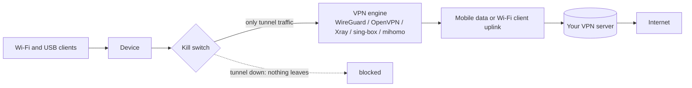

# VPN

**一句话概括：** 一个可选模块 `openf50-vpn`，把设备自身的流量**以及**来自其 Wi-Fi 和 USB 客户端的一切，
都送进你的 VPN 服务器，并带断流开关，隧道断开时什么都不泄漏。

**通俗版说明：** 想象离开房子的每个包裹都先装进一辆上锁的货车。断流开关的意思是：货车不在时，包裹在
门口等着，而不是不加保护地发出去。

VPN 是一个独立项目，有自己的发布包：**[dikeckaan/mu300-linux-vpn](https://github.com/dikeckaan/mu300-linux-vpn)**。
它的 README 是完整参考（命令、配置、设置、安全模型）。本页是简短导览。



## 安装模块

它需要 openf50-linux **v2026.10.16 或更新**；模块 **v2.0.0**（核心加引擎 extras、订阅、面板的 VPN
区块、IPv6 防护）需要 **v2026.10.20 或更新**。安装器会问；否则在设备上：

```sh
sudo openf50-extra install vpn                                # online: the core and the engines its profiles need (first time: Xray)
sudo openf50-vpn engine install sing-box                      # each engine is an extra: xray, sing-box, mihomo, dae
sudo openf50-extra install vpn-mihomo                         # the same, by the extra's name (vpn-xray, vpn-singbox, vpn-dae)
sudo openf50-extra install vpn --from /mnt/usb/               # offline, verified: a directory with the tarballs and their SHA256SUMS
sudo openf50-extra remove vpn-mihomo                          # an engine; refused while the VPN runs on it
sudo openf50-extra remove vpn                                 # turn the VPN off first
```

OpenWrt 上去掉 `sudo`。模块住在 Linux 分区上（`/mnt/openf50-disk/extra/vpn`，引擎在 `extra/vpn-xray`
等），所以 Ubuntu 和 OpenWrt 共用一份，且更新会把核心和引擎作为一组带到它们的最新发布包。tarball 只有
在其哈希出现在旁边的 `SHA256SUMS` 里时才会被安装（v1 模块升级时保留它的两个引擎）。在带控制面板的
OpenWrt 上，这一切也在面板的 **VPN** 菜单里（见
[Control Panel (LuCI)](Control-Panel-(LuCI)#the-panels-pages)）；在带 panel extra 的 Ubuntu 上，Cockpit
里的 OPENF50 页面开关 VPN 并选择配置。两个面板和 `openf50-toolkit` 一样，只在模块安装后才显示 VPN
区块：没有它，里面没有任何 VPN 的影子。

## 使用

```sh
sudo openf50-vpn profile import ~/office.conf Office    # a file: WireGuard .conf, .ovpn, Xray/sing-box .json, mihomo .yaml
cat client.ovpn | sudo openf50-vpn profile import -     # from stdin, so nothing is left in the process list
openf50-vpn profile list                                # * marks the active one
sudo openf50-vpn profile use office                     # make it active
sudo openf50-vpn on                                     # start now and at every boot
openf50-vpn status                                      # profile, engine, tunnel, exit IP (never a secret)
sudo openf50-vpn off                                    # stop, and remove the kill switch
```

分享链接（`vless://`、`vmess://`、`trojan://`、`ss://`）也可以导入；它们最好走 stdin，这样链接不会留在
你的 shell 历史里。`openf50-toolkit` 有一个 VPN 菜单。

## 支持什么

| 配置 | 引擎 |
|---|---|
| WireGuard `.conf` | 内核的 WireGuard（主线内核；5.4 厂商内核没有） |
| OpenVPN `.ovpn` | 系统的 OpenVPN 包：`apt-get install openvpn`（Ubuntu）、`apk add openvpn-openssl`（OpenWrt） |
| VLESS、VMess、Trojan、Shadowsocks 链接；Xray JSON | Xray-core 加 hev-socks5-tunnel |
| 断流开关后的同类链接；sing-box JSON | sing-box |
| Clash/mihomo YAML | mihomo（`openf50-extra install vpn-mihomo`） |
| hysteria2、TUIC 链接；dae 配置 | [dae](https://github.com/daeuniverse/dae)，eBPF 代理（`openf50-extra install vpn-dae`）：需要 v2026.10.20 或更新的 6.18 或 7.2 内核（它们带 BTF）；绝不用 5.4 |

Tailscale 自己的流量默认走隧道。

**订阅**（v2）：`openf50-vpn subscription add NAME URL` 接受一个能产出配置的 URL（分享链接、mihomo 或
dae 列表），手动或按计划刷新；刷新会覆盖对其配置做过的编辑。

## 值得知道的设置

`openf50-vpn settings set KEY VALUE`，摘自模块 README：

| 键 | 默认 | 含义 |
|---|---|---|
| `KILL_SWITCH` | 1 | 除隧道外什么都不离开设备，隧道断开时也一样 |
| `TAILSCALE` | 1 | Tailscale 的流量走隧道 |
| `IPV6` | auto | `auto`：隧道承载 IPv6 时走隧道，否则在隧道旁**阻断** IPv6，什么都不从断流开关旁漏过（IPv6 防护，v2）；`1` 总是，`0` 永不 |
| `REMOTE_DNS` | 1.1.1.1 | 设备及其客户端的 DNS，走隧道 |
| `LAN_CIDRS` | 空 | 保持本地的额外网段（设备自己的 LAN 总是本地） |

## 失败时关闭（fails closed）

* 开着 VPN 的设备绝不会在没有模块的情况下被更新。离线时，`openf50-update apply` 在改动任何东西之前停
  下并说明如何暂存（见 [Updating](Updating#with-the-vpn-on)）。
* 开着带断流开关的 VPN 却丢了模块的系统，会让移动数据和 Wi-Fi 客户端保持**关闭**，直到模块重新安装
  （`openf50-extra install vpn`）或 VPN 关闭。缺失的引擎同样以失败关闭方式处理——在断流开关后面——服务
  会重新获取它；`openf50-toolkit` 会说明是哪一个。
* VPN 正在某引擎上运行时，`openf50-extra remove vpn-<engine>` 会被拒绝。

## 已知限制

一些运营商丢 UDP 并通过深度包检测封 OpenVPN。包含 `direct`/`freedom` 出站的原始
Xray/sing-box/mihomo 配置会让那部分流量按它自己的选择走隧道外、越过断流开关。

> 使用 VPN 可能违反运营商条款或当地法律。开启前请先确认。
