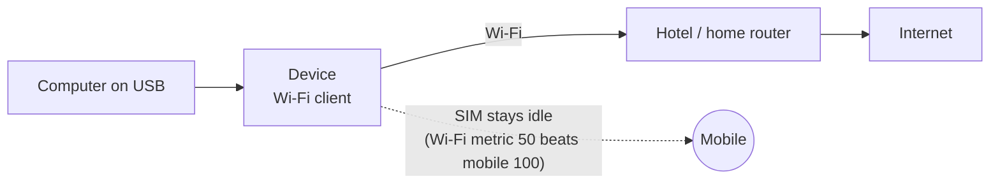

# Wi-Fi Hotspot and Client

**一句话概括：** 设备的 Wi-Fi 要么是供你的手机和电脑加入的**热点**，要么是加入别人 Wi-Fi 的**客户端**，
二选一，绝不同时。

**通俗版说明：** Wi-Fi 射频只有一张嘴。它要么说（做热点），要么听（加入别的网络），不能同时。热点是
默认。

## 热点

* **5 GHz（802.11ac）或 2.4 GHz**，一次一个：芯片（SC2355）只提供一个接入点。
* 默认使用**从 Android 复制的名称和密码**（安装器会问）。没有的话，会生成随机密码并在登录时显示。
* Wi-Fi 客户端和 USB 客户端共享一个 LAN，所以它们能互相看到对方和设备。
* 热点是 **WPA2**。镜像里没有 WPA3：在这颗芯片上固件自己完成 WPA3 交换，唯一的使用方式是为 U30 Air
  在 OpenWrt 上自行构建实验版本，且有一个悬而未决的安全问题
  （[U30AIR-SAE.md](https://github.com/dikeckaan/openf50-linux/blob/main/docs/U30AIR-SAE.md)）。在普通
  镜像的 LuCI 里选 WPA3 会得到一个谁也加不进来的热点。

### 改名称、密码或频段

| 系统 | 方法 |
|---|---|
| Ubuntu | 编辑 `/etc/openf50/hotspot.conf`（`SSID=`、`PSK=`、`BAND=5` 或 `2.4`、`CHANNEL=auto` 或数字、`COUNTRY=`），然后 `sudo systemctl restart openf50-hotspot` |
| OpenWrt | LuCI -> Network -> Wireless（`hotspot.conf` 文件只在首次启动时读取一次） |
| U30 Air | Wi-Fi 键切换 2.4 / 5 GHz；按住 3 秒关闭或打开热点 |

5 GHz 上固件允许信道 36-48 和 149-165；如果它拒绝 5 GHz，热点回退到 2.4 GHz。

**不用 DFS 信道**（v2026.10.20 起）。热点绝不运行在 DFS 信道上（52-64 和 100-144，少数国家更多）：
接入点在那里必须先监听雷达，而 Wi-Fi 驱动做不到，所以 hostapd 会以 `start_dfs_cac() failed` 停止，热点
起不来。`hotspot.conf` 或 LuCI 里的 DFS 信道会被替换成信道 36（在不允许 36-48 的国家换成 149），日志
里有一行说明原因（Ubuntu 上 `journalctl -u openf50-hotspot`，OpenWrt 上 `logread`）；`auto` 也绝不会
选中它们。LuCI 仍会列出 DFS 信道；在 OpenWrt 上设置本身会在下次启动时改成替代信道。以客户端身份加入
别人在 DFS 信道上的 Wi-Fi 照旧可用。v2026.10.18 及之前的发布包会拒绝在这样的信道上启动
（`start_dfs_cac() failed`）；在那里请选择 36-48 或 149-165。

**谁连着：** 在带控制面板的 OpenWrt 上，首页列出 Wi-Fi 客户端及其收发速率、连接时长、主机名和地址
（v2026.10.20 起；之前这些列一直是空的）。

## Wi-Fi 客户端（加入别的网络）



```sh
sudo wifi-client scan                    # the networks in range: signal, security, name
sudo wifi-client connect "NAME"          # asks for the password; nothing is shown as you type
sudo wifi-client connect "NAME" --open   # an open network
sudo wifi-client status
sudo wifi-client disconnect              # the hotspot comes back, and stays after a reboot
sudo wifi-client reconnect               # join the saved network again
sudo wifi-client forget                  # delete the saved network
```

或者用菜单：`sudo openf50-toolkit` -> Network -> Wi-Fi -> "Join a network"。

**须知：**

* **模式在启动时决定。** 射频是热点时，`connect` 保存网络并要求重启（`openf50-toolkit` 提供热点关闭的
  重启，用于扫描）。
* **WPA2 和 WPA2/WPA3 混合网络可以；仅 WPA3 的不行。** 这个驱动没有 SAE。扫描会把它们标为 `WPA3`；把
  路由器设成 WPA2/WPA3 混合模式即可加入。
* **被问到时再输密码**，不要写在命令行上：`sudo` 会把整条命令行写进系统日志。脚本里用：
  `printf '%s\n' "$PW" | sudo wifi-client connect "NAME" -`，或 `--password-file FILE`。
* 加入的网络保存在 `/etc/openf50/wifi-client.conf`（仅 root），每次启动都会重新加入。
* `disconnect` 跨重启保持；`disconnect --keep` 让下次启动时仍加入该网络。
* Wi-Fi 芯片固件崩溃时，驱动会复位它，Wi-Fi 自己回来：热点自 v2026.10.17 起，加入别的网络的 Wi-Fi
  客户端自 v2026.10.18 起（以前会重启设备）。

### 共享什么，不共享什么

USB 客户端经加入的网络到达**互联网**，且只有互联网：那个网络自己的设备和路由器（私有、链路本地、
CGNAT 和其他特殊地址）以及任何 IPv6 的东西，都从设备的 LAN 够不到。所以设备 USB 上的客人不会落到你的
家庭或酒店网络里。从加入的网络那边，只有 ping、DHCP、IPv6 邻居发现和应答能进来：SSH 和设备的其他服务
对它是关闭的（要连设备请用 USB）。开着 [VPN](VPN) 时，流量仍走隧道，断流开关也覆盖 Wi-Fi 上行链路。
完整的防火墙描述在
[README](https://github.com/dikeckaan/openf50-linux#wi-fi-client)。

## 已知问题

* 持续 Wi-Fi 负载下，厂商驱动在丢包时会记录 `edma_pending_q_buffer full` / `push link fail`；传输会
  完成。
* 热点开着时挂起会立即返回（hostapd 的闹钟定时器）。

为什么一次只能一种模式、为什么 5 GHz 需要补丁：
[FINDINGS 14b、23](https://github.com/dikeckaan/openf50-linux/blob/main/docs/FINDINGS.md)。
